# PortfolioLab 📊

**A full-stack web app that analyses an investment portfolio the way a private banker would — for free, starting from just ISINs or tickers.**

Search stocks, ETFs, bonds and crypto, build a portfolio (or import it from a bank PDF with Claude), and get asset allocation, look-through exposure, risk metrics, efficient frontier, Monte Carlo projections and your total net worth, in six languages.


### 🚀 Live demo

| Environment | URL |
| --- | --- |
| **Production** | **<https://dqkf2tf9x884l.cloudfront.net>** |
| Development (latest features) | <https://d1iw5uep2d5wy6.cloudfront.net> |

Create a free account, then click **Load demo portfolio** to get a full dashboard in one click. Both environments run the same serverless stack on AWS (CloudFront → S3 + API Gateway → Lambda → DynamoDB), deployed with Terraform.

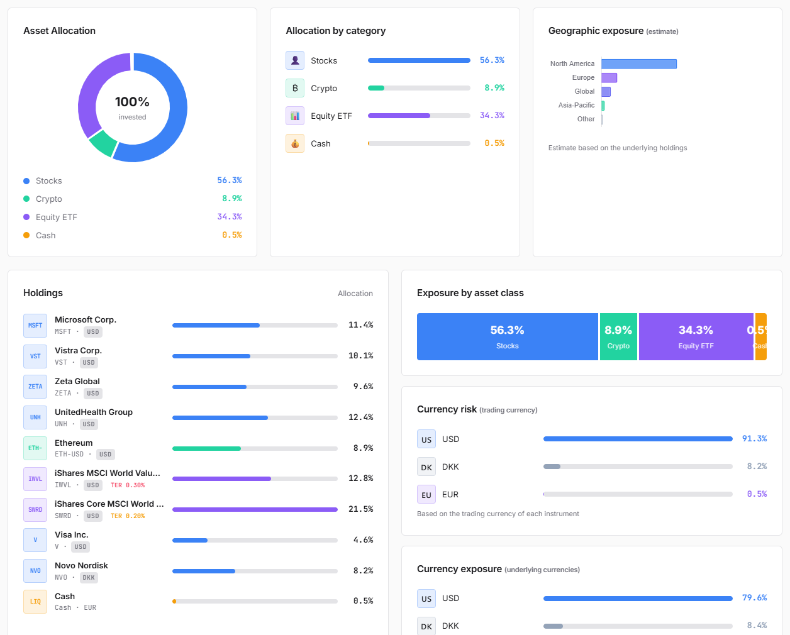

---

## Contents

- [Live demo](#-live-demo)
- [Features](#features)
- [Screenshots](#screenshots)
- [How it works](#how-it-works)
- [Tech stack](#tech-stack)
- [Getting started](#getting-started)
- [Tests](#tests)
- [Deploy on AWS](#deploy-on-aws)
- [Project structure](#project-structure)
- [Documentation](#documentation)

---

## Features

| Area | What it does |
| --- | --- |
| 🔍 **Instrument search** | Resolve any ISIN or ticker (stocks, ETFs, bonds, crypto) via OpenFIGI + Yahoo Finance. Bonds are detected automatically and priced from Borsa Italiana (MOT / EuroTLX). |
| 📄 **AI import from PDF** | Upload a bank statement: Claude extracts the positions (ISIN, quantity, price) into the portfolio. |
| 📊 **Dashboard** | Asset allocation, geographic and currency exposure, weighted TER, estimated return/volatility/Sharpe, risk profile, 1Y performance and P&L from purchase price. |
| 🔬 **Deep analysis** | TWR and MWR (XIRR), contribution per position, drawdown, look-through inside ETFs (real sectors, regions, overlaps), risk table (Sharpe, Sortino, Calmar, beta, VaR/CVaR), correlation heatmap, efficient frontier, return distribution, 10-year Monte Carlo, comparison with 100/0, 80/20 and 60/40 allocations. |
| 🧠 **Superinvestors** | Most-held stocks among value investors (Buffett, Ackman, Pabrai…) from SEC 13F filings, their portfolios, and the overlap with yours. |
| 🌍 **Bond yields map** | Interactive world map of 10/20/30-year government-bond yields, spread over the German Bund, daily change and 52-week range. |
| 🏠 **Net worth** | Life insurance, pension funds, real estate with mortgage amortisation, private markets: added to the saved portfolios to compute net worth, with pension and policy projections. |
| 🔐 **Accounts** | Registration, login with rotating JWT sessions (15-min idle expiry, server-side revocation), bcrypt, lockout after failed attempts, reCAPTCHA v3, password reset via SES. |
| 🌐 **i18n & theming** | Italian, English, French, German, Spanish, Japanese; dark/light theme. |

---

## Screenshots

> Captured on a demo portfolio with live market data (light theme; a dark theme is also available).

### Deep analysis — return since purchase
TWR vs MWR, market value vs invested capital, benchmark comparison and drawdown.

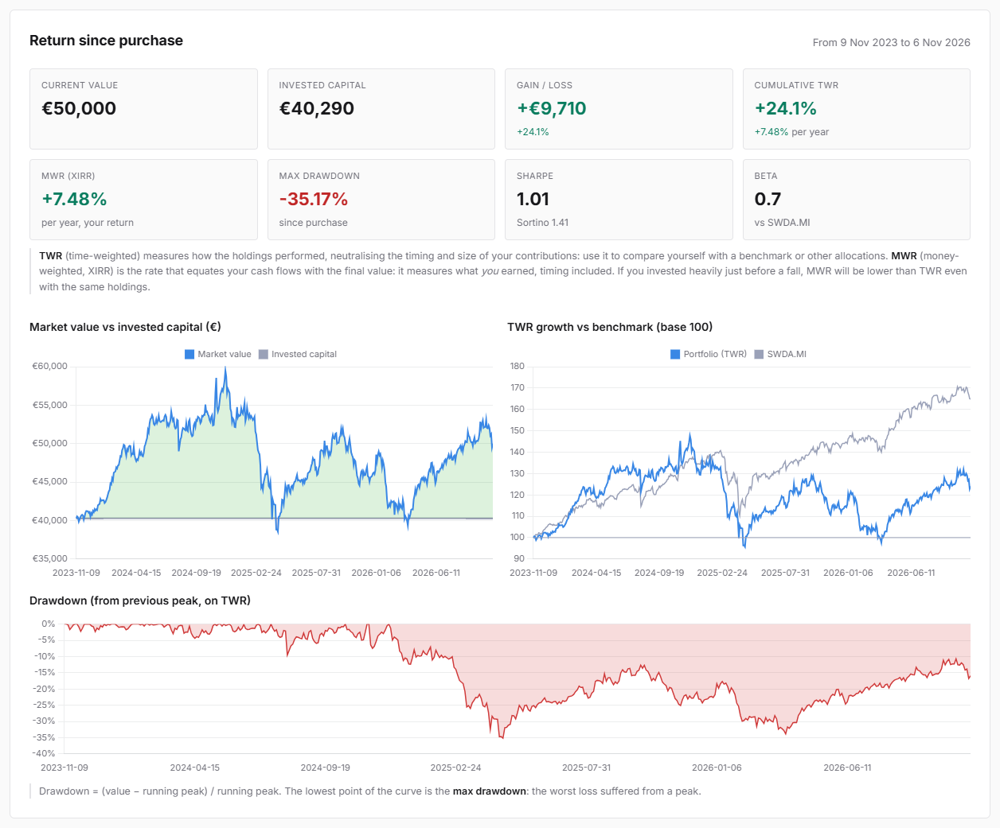

### Look-through — what you really own inside your ETFs
Asset classes, regions and sectors computed from the underlying holdings, with overlaps between funds.

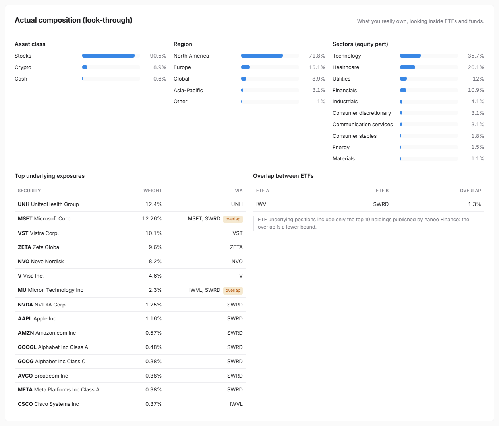

### Risk / return and correlations
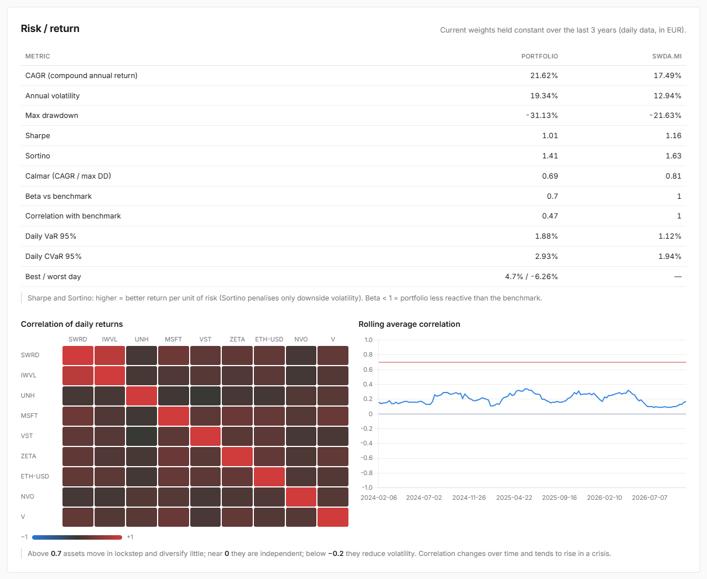

### Efficient frontier
Where the portfolio sits on the risk/return trade-off, with the minimum-volatility and maximum-Sharpe portfolios.

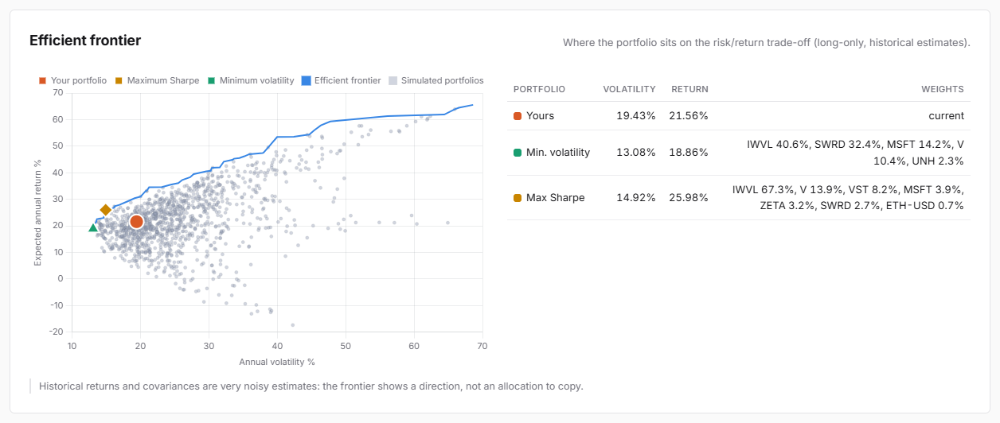

### Return distribution and Monte Carlo simulation
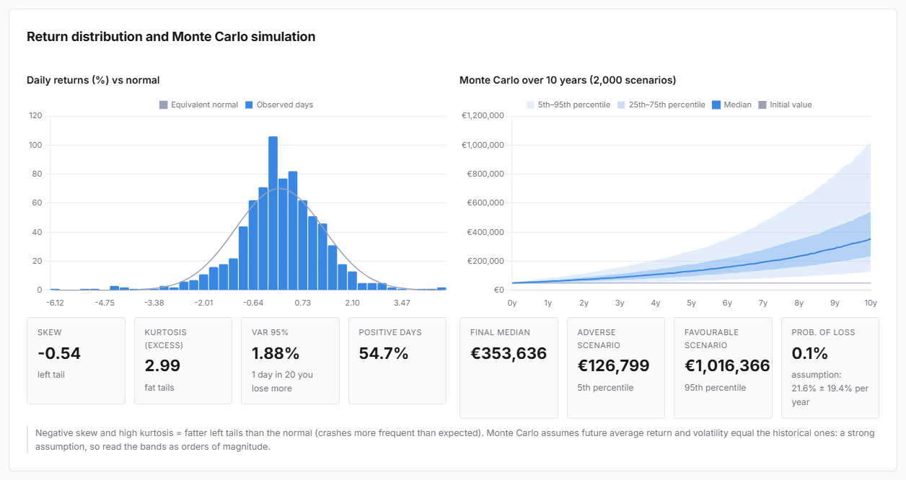

### Government bond yields map
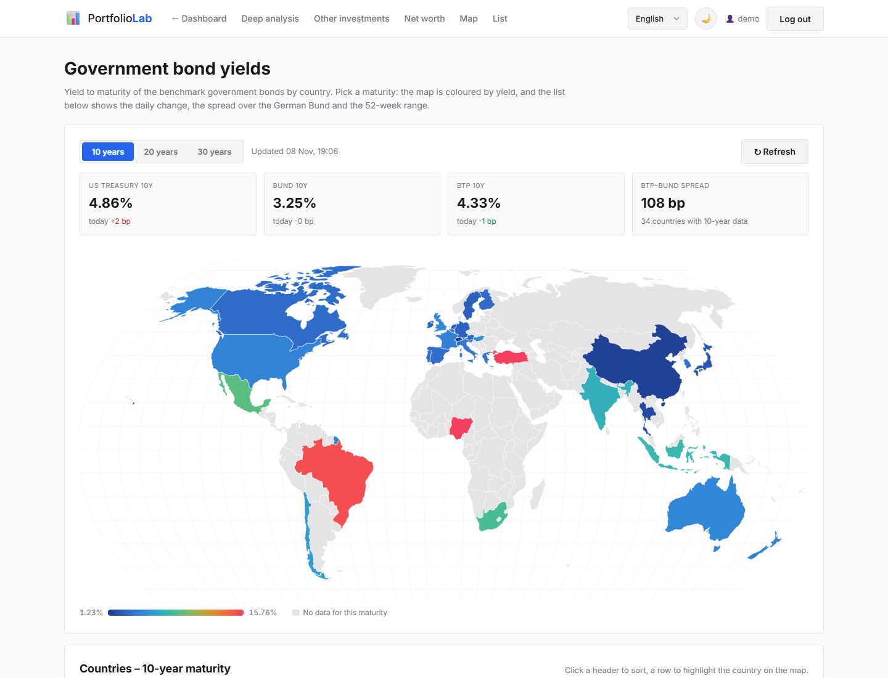

### Total net worth
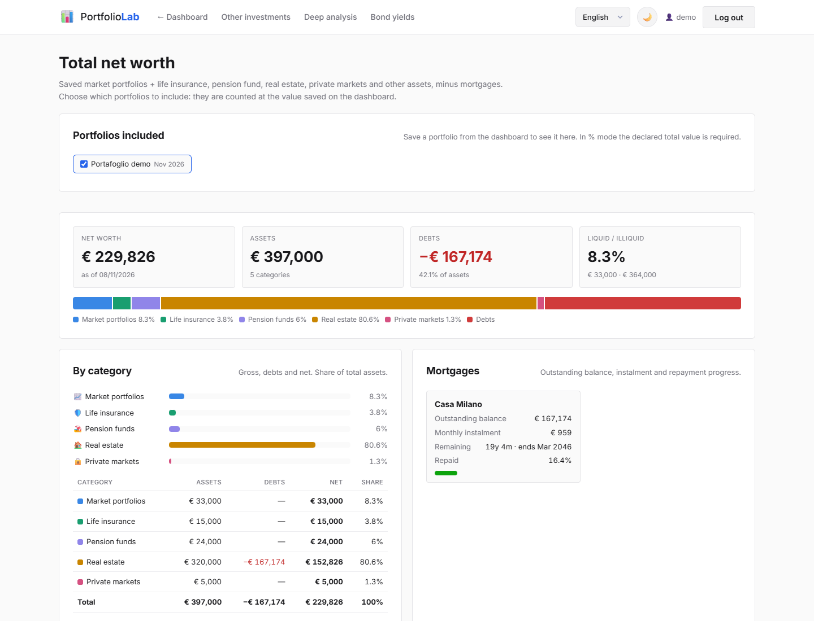

<details>
<summary><b>More screenshots</b> — superinvestors, other investments, landing</summary>

#### Superinvestors (SEC 13F)
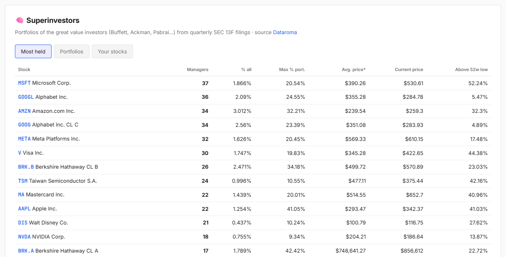

#### Other investments (insurance, pension funds, real estate…)
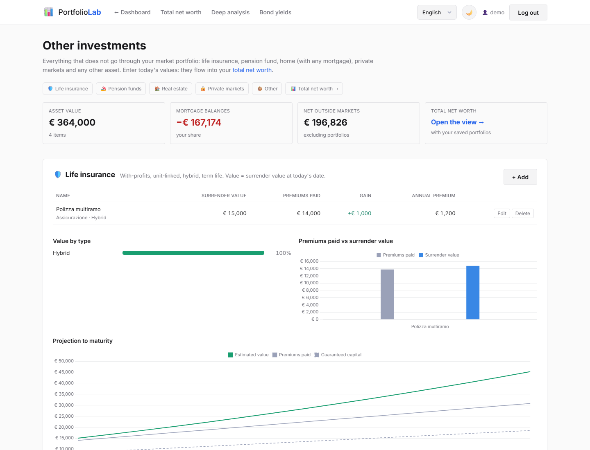

#### Portfolio builder
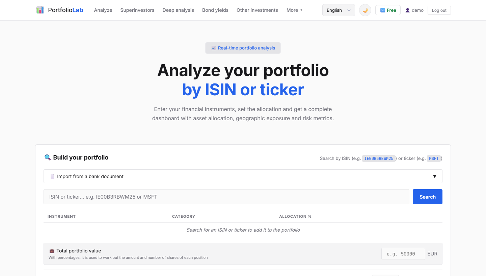

</details>

---

## How it works

The frontend is static HTML + vanilla JS (no build step); the backend is a FastAPI app that runs locally with uvicorn and on AWS Lambda through the Mangum ASGI adapter.

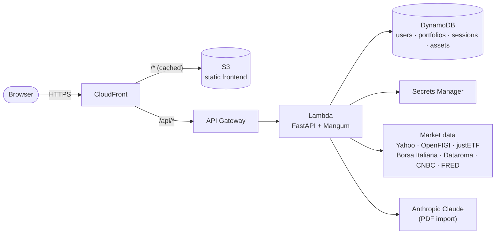

A typical flow:

1. **Search** — `GET /api/search?q=IE00B3RBWM25` resolves the ISIN with OpenFIGI, fetches price, currency, TER and geography (Yahoo Finance, justETF), or the bond quote from Borsa Italiana.
2. **Analyse** — `POST /api/portfolio/analyze` returns allocation, exposures and estimated metrics; `POST /api/portfolio/performance` the historical curve.
3. **Deep analysis** — `POST /api/analysis/deep` downloads price and FX history, rebuilds each position from its purchase date and computes returns, risk, frontier and Monte Carlo; `POST /api/analysis/look-through` opens up ETFs and funds.
4. **Persist** — portfolios and other assets are saved per user in DynamoDB; `POST /api/wealth/summary` combines them into net worth.

Every request and response crossing a boundary is a **Pydantic model**; the pure maths (`portfolio_metrics.py`, `wealth.py`, `projections.py`) has no I/O and is unit-tested in isolation. Full endpoint reference in [doc/backend.md](doc/backend.md), formulas in [doc/analisi.md](doc/analisi.md).

---

## Tech stack

| Layer | Technologies |
| --- | --- |
| Backend | Python 3.11+, FastAPI, Pydantic v2, NumPy/pandas, yfinance, requests, python-jose, bcrypt, Anthropic SDK, pypdf |
| Frontend | HTML, CSS, vanilla JavaScript, Chart.js, D3 + TopoJSON (yield map) |
| Data sources | Yahoo Finance, OpenFIGI, justETF, Borsa Italiana, Dataroma, CNBC, FRED |
| Cloud | AWS Lambda (container image), API Gateway HTTP API, CloudFront, S3, DynamoDB, Secrets Manager, SES, WAF, ECR |
| Infrastructure as code | Terraform (prod and dev environments via workspaces) |
| Tooling | uv, pytest, ruff, mypy, Docker |

---

## Getting started

### Prerequisites

- [uv](https://docs.astral.sh/uv/) (installs Python 3.11+ for you)
- AWS credentials with access to DynamoDB — the tables are created automatically on first start
- Optional: an [Anthropic API key](https://console.anthropic.com) for the PDF import, a free [FRED API key](https://fred.stlouisfed.org/docs/api/api_key.html) for sovereign-bond risk

### Run locally

```bash
git clone https://github.com/Tenenti-lorenzo/investment_monitoring.git
cd investment_monitoring

uv sync                                          # create .venv and install dependencies
cp .env.example .env                             # then set SECRET_KEY (see below)
uv run uvicorn backend.main:app --reload --port 8000
```

Open <http://localhost:8000>, create an account and click **Load demo portfolio** to see a complete dashboard straight away.

Shortcuts: `./run.sh` (macOS/Linux) or `.\run.ps1` (Windows).

### Environment variables (`.env`)

```dotenv
SECRET_KEY=change-me-to-a-random-string-of-at-least-32-chars
AWS_REGION=eu-central-1
ANTHROPIC_API_KEY=sk-ant-...        # optional: PDF import
FRED_API_KEY=...                    # optional: sovereign-bond risk
```

All variables (DynamoDB table names, reCAPTCHA, SES/SMTP…) are listed in [doc/riferimenti.md](doc/riferimenti.md#variabili-dambiente).

---

## Tests

```bash
uv run pytest            # 434 offline tests, ~15 s
uv run pytest -m live    # check the scrapers against the real websites
```

The suite never touches the network: HTTP and Yahoo Finance are blocked by an autouse fixture, scrapers run on real HTML pages saved in [tests/fixtures/](tests/fixtures/), and DynamoDB is replaced by an in-memory fake. The `live` marker exists to catch layout changes on the scraped sites. Details in [doc/testing.md](doc/testing.md).

---

## Deploy on AWS

The whole stack is defined in [terraform/](terraform/). Copy `terraform/terraform.tfvars.example` to `terraform.tfvars`, fill in the secrets, then:

```powershell
.\deploy.ps1 first-deploy                  # ECR → Docker image → full infrastructure → static files
.\deploy.ps1 deploy                        # later releases: new image + static files + CDN invalidation
.\deploy.ps1 deploy -Environment dev       # same, on the separate dev stack
```

On macOS/Linux the [Makefile](Makefile) offers the same targets (`make first-deploy`, `make deploy`). See [doc/infrastruttura.md](doc/infrastruttura.md).

---

## Project structure

```
investment_monitoring/
├── backend/                  # FastAPI app (also the Lambda entry point: backend.main.handler)
│   ├── main.py               # routes, auth, search, base analysis
│   ├── deep_analysis.py      # /api/analysis/deep orchestration
│   ├── look_through.py       # ETF / fund look-through
│   ├── portfolio_metrics.py  # pure maths: CAGR, Sharpe, XIRR, frontier, Monte Carlo
│   ├── price_history.py      # price + FX history download
│   ├── bonds.py, bond_market.py, sovereign_yields.py   # bonds and government yields
│   ├── superinvestors.py     # Dataroma 13F scraper
│   ├── wealth.py, projections.py                       # net worth, pension/policy projections
│   ├── *_models.py           # Pydantic contracts
│   └── database.py, session_store.py                   # DynamoDB access
├── frontend/                 # static pages + static/{css,js,i18n}
├── tests/                    # pytest suite, fakes and HTML fixtures
├── terraform/                # AWS infrastructure
├── doc/                      # technical documentation and screenshots
├── Dockerfile                # Lambda container image
├── deploy.ps1, Makefile      # deploy automation
└── pyproject.toml, uv.lock
```

---

## Documentation

The [doc/](doc/) folder (in Italian) describes the system in depth:

| Page | Content |
| --- | --- |
| [Architecture](doc/architettura.md) | Components, request flow, cold start |
| [Backend / API](doc/backend.md) | Modules, endpoints, Pydantic models |
| [Deep analysis](doc/analisi.md) | Methodology and formulas (TWR, MWR, risk, look-through, bonds) |
| [Database](doc/database.md) | DynamoDB schema and access functions |
| [Frontend](doc/frontend.md) | Pages, client state, charts |
| [Infrastructure](doc/infrastruttura.md) | Terraform resources, IAM, deploy |
| [Tests](doc/testing.md) | Offline suite, fixtures, live tests |
| [References](doc/riferimenti.md) | External services, environment variables, glossary |

---

> **Disclaimer** — PortfolioLab is a personal project for educational purposes. Market data come from free public sources and may be delayed or inaccurate; nothing in the app is investment advice.
